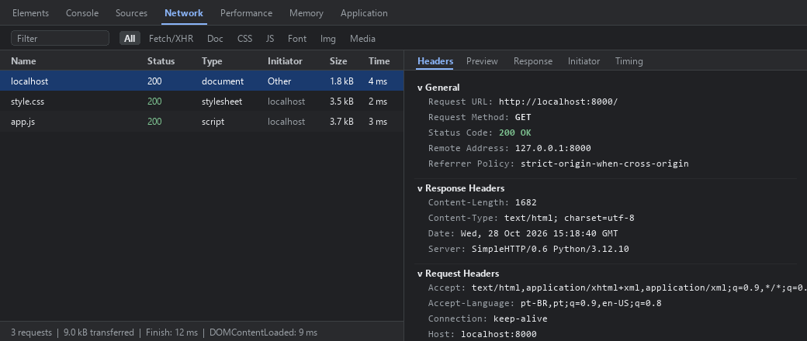

# Bolso Universitário

Aplicação web desenvolvida para a disciplina de **Desenvolvimento de Sistemas Web (EECP0036)** na **Universidade Federal do Maranhão (UFMA)**, ministrada pelo Prof. Renan Sousa Freire.

* **Aluno:** Victor Eduard Rodrigues Cabral
* **Matrícula:** 20240005760
* **Tema:** 10. Controle de gastos
* **Trilha:** Trilha C (sem API externa - JavaScript puro e localStorage)

---

## 1. Sobre o Aplicativo

O **Bolso Universitário** é uma aplicação web minimalista pensada para estudantes universitários controlarem despesas rápidas do dia a dia (como almoço no RU, passagens de ônibus, impressões e lanches), mantendo o cálculo do total gasto sempre atualizado.

A interface utiliza a paleta de cores institucional inspirada no aplicativo da UFMA (tons de vinho `#82002d`, detalhe dourado `#c9a265` e cartões claros) e a fonte **Roboto**, adaptada para uso direto no navegador tanto no computador quanto no celular.

---

## 2. O que o app faz e o que não faz

### O que o app faz:
* Adiciona novas despesas com descrição, data do registro e valor em reais (R$).
* Calcula e exibe o total gasto acumulado em tempo real.
* Permite remover itens individuais da lista de despesas.
* Salva e carrega a lista automaticamente no navegador usando `localStorage`.
* Valida entradas vazias ou valores inválidos exibindo uma mensagem de aviso na tela, sem quebrar a página.
* Insere todos os dados digitados utilizando exclusivamente `textContent`, prevenindo injeção de código (XSS).

### O que o app não faz:
* Não possui sistema de login ou criação de conta.
* Não faz sincronização de dados na nuvem ou entre aparelhos.
* Não realiza integração bancária nem gera gráficos complexos.

---

## 3. Como rodar o projeto

1. Abra o terminal na pasta do repositório.
2. Inicie um servidor HTTP local com Python:
   ```bash
   python -m http.server 8000
   ```
3. No navegador, acesse:
   ```
   http://localhost:8000
   ```

*(Também é possível abrir utilizando a extensão Live Server no VS Code).*

---

## 4. Aba Rede (Network)

Seguindo as instruções da Seção 6 da atividade para a **Trilha C**, a página foi servida localmente em `http://localhost:8000` e a requisição principal foi capturada na aba **Network** das ferramentas de desenvolvedor (F12):



A captura mostra a requisição HTTP `GET` feita pelo navegador para `http://localhost:8000/`, que retornou o status `200 OK` com o documento HTML da página, seguida pelo carregamento do `style.css` e do `app.js`. Como o projeto segue a Trilha C, não há chamadas para APIs externas e os gastos são persistidos localmente no `localStorage`.

---

## 5. Uso de IA

* **Ferramenta:** Gemini (Google).
* **O que foi pedido:** Auxílio na estruturação do layout em HTML/CSS responsivo e revisão da lógica de manipulação do DOM e armazenamento no `localStorage`.
* **O que foi alterado:** Ajustes nas cores e espaçamentos da interface, simplificação das funções de validação e formatação de moeda em `app.js`, e remoção de elementos visuais desnecessários para manter o escopo enxuto proposto na Etapa 1.
